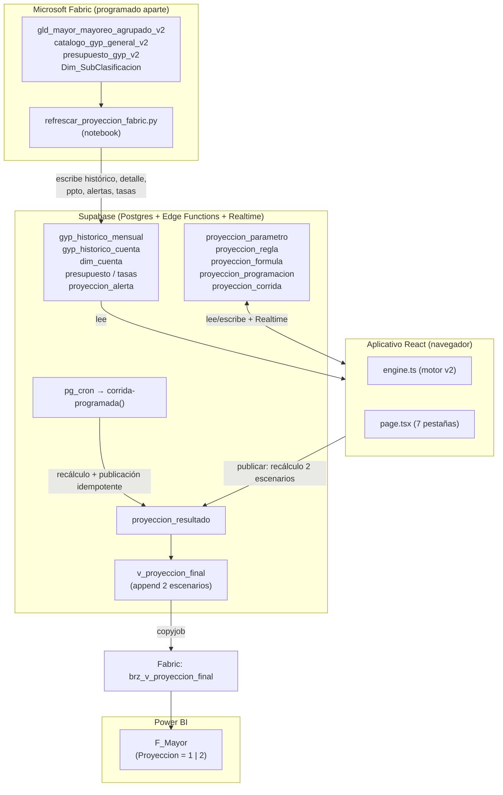
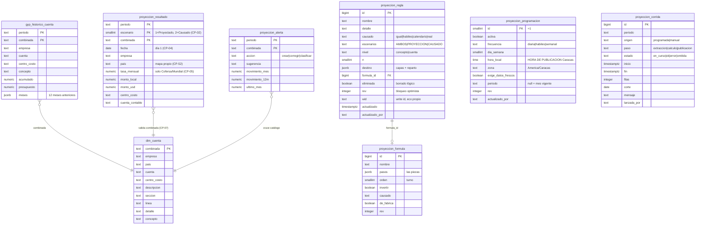
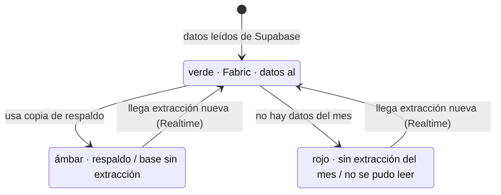
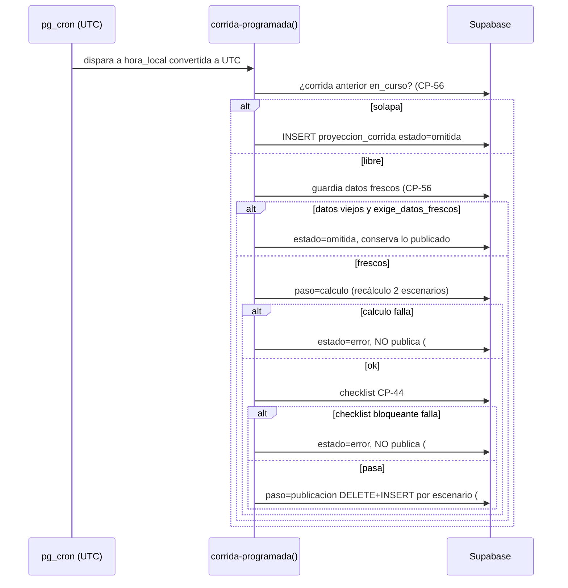

# Design Document

## Overview

Este documento diseña la reescritura completa del módulo de Proyección GyP en producción (`src/pages/proyeccion-gyp/`), cubriendo el paquete CP-01…CP-56 y la especificación de referencia del motor (Parte II §A–§H) de `12-cambios-para-produccion.md`. No es greenfield: el módulo ya corre en producción y la reescritura debe **reproducir sus números de forma idéntica** (190 casos validados) mientras incorpora las siete fases del orden sugerido.

El diseño está organizado por las **siete fases** en el orden de ejecución obligatorio: primero la base de datos, luego el motor, los datos, la interfaz, la extracción/operación, la programación y la verificación.

### Restricciones no negociables (gobiernan todo el diseño)

- **R-NN-1**: El motor replica idénticas las fórmulas de la Parte II §A–§H. Ningún refactor puede alterar la aritmética sin pasar la compuerta de 190 casos.
- **R-NN-2**: El grupo SEMI (ISLR) se calcula y se muestra aparte; **no** resta en el Semi Neto.
- **R-NN-3**: Montos en signo crudo (ingresos negativos, gastos positivos).
- **R-NN-4**: Claves internas heredadas `Personal Fijo`, `Logistico`, `Depreciacion`, `Colocacion` **no se renombran**; en pantalla se muestran los nombres de `Dim_SubClasificacion`.
- **R-NN-5**: Credenciales de Supabase solo en backend/Key Vault; nunca en repo, navegador ni logs.

### Inventario de archivos: reescritura vs nuevo

| Archivo | Acción | Fase |
|---|---|---|
| `src/pages/proyeccion-gyp/schema.sql` | **Reescritura** (idempotente, migraciones §4) | 1 |
| `src/pages/proyeccion-gyp/engine.ts` | **Reescritura** (motor v2: pasos, operaciones, causado, destino, 2 escenarios) | 2 |
| `src/pages/proyeccion-gyp/data.ts` | **Reescritura** (lectura cuenta/alerta/ppto, rev/wid, realtime, borrado lógico) | 3 |
| `src/pages/proyeccion-gyp/page.tsx` | **Reescritura** (7 pestañas) | 4 |
| `src/pages/proyeccion-gyp/seed.ts` | **Reescritura** (métodos de fábrica §D, CIFRAS_VALIDADAS ampliadas) | 2, 7 |
| `src/pages/proyeccion-gyp/series.ts` | **Reescritura/retiro** (la foto embebida pasa a Supabase; se conserva solo como fallback de la Suite_Verificacion) | 2, 7 |
| `fabric/refrescar_proyeccion_fabric.py` | **Reescritura** (suma corregida, serie 12m, ppto, detalle por cuenta, 2 meses, alertas) | 5 |
| `src/pages/proyeccion-gyp/engine.test.ts` | **Nuevo** (suite de 190 casos + propiedades) | 2, 7 |
| `src/pages/proyeccion-gyp/capas.ts` | **Nuevo** (resolución de bases por capas del catálogo, CP-16) | 2 |
| `src/pages/proyeccion-gyp/causado.ts` | **Nuevo** (4 modos de causado §E) | 2 |
| `src/pages/proyeccion-gyp/destino.ts` | **Nuevo** (reparto §F) | 2 |
| `src/pages/proyeccion-gyp/wape.ts` | **Nuevo** (recomendación/backtest §G) | 4 |
| `src/pages/proyeccion-gyp/salida.ts` | **Nuevo** (contrato de 13 columnas, fusión, validación CP-04..07/52) | 1 |
| `src/pages/proyeccion-gyp/checklist.ts` | **Nuevo** (CP-44) | 7 |
| `src/pages/proyeccion-gyp/components/*.tsx` | **Nuevo** (paneles de las 7 pestañas) | 4 |
| `supabase/functions/publicar-proyeccion/index.ts` | **Nuevo** (publicación idempotente transaccional, usada por botón y por cron) | 1, 6 |
| `supabase/functions/corrida-programada/index.ts` | **Nuevo** (CP-56; invocada por pg_cron) | 6 |
| `supabase/migrations/NNNN_proyeccion_produccion.sql` | **Nuevo** (espejo versionado de schema.sql) | 1 |

---

## Architecture

### Arquitectura de datos (Fabric → Supabase → app → v_proyeccion_final → Power BI)

El aplicativo **no consulta Fabric** (el firewall de Fabric no acepta la IP de Supabase). Fabric empuja a Supabase; el aplicativo lee de Supabase. Los dos horarios (notebook de Fabric y publicación del aplicativo) son **independientes**.



El aplicativo programa **solo los dos últimos pasos** de la cadena: recálculo de los dos escenarios y publicación de la tabla final (CP-56). La extracción la corre Fabric por su cuenta.

---

## Data Models

### Modelo de datos (tablas nuevas y columnas añadidas)



---

## Components and Interfaces

Los componentes se describen organizados por las siete fases del orden de ejecución obligatorio. Cada fase es una capa con su interfaz: la migración de base de datos, el motor puro (`engine.ts` + módulos `capas/causado/destino`), la capa de datos (`data.ts`), la interfaz (`page.tsx` + componentes), la extracción (notebook Fabric), la programación (Edge Functions + pg_cron) y la verificación (suite + checklist).

### Fase 1 — Migración de base de datos (CRÍTICA, primero)

**Objetivo:** aplicar todo el esquema del §4 **antes** de tocar `engine.ts`, `data.ts` o `page.tsx` (Req 1.5), sin romper datos existentes.

### Versionado e idempotencia

- `schema.sql` se reescribe como **idempotente**: `ADD COLUMN IF NOT EXISTS`, `CREATE TABLE IF NOT EXISTS`, `CREATE UNIQUE INDEX IF NOT EXISTS`. Es la fuente de verdad legible del esquema.
- Un espejo versionado vive en `supabase/migrations/NNNN_proyeccion_produccion.sql` para que Supabase aplique el cambio de forma reproducible en despliegue.
- La migración se aplica en una transacción; si falla, no deja el esquema a medias.

### Sentencias (del §4)

**Salida.** Añadir `escenario` con default 1 (las filas existentes quedan como Proyectado, que es lo que hoy se publica), y el índice único por escenario:

```sql
ALTER TABLE proyeccion_resultado
  ADD COLUMN IF NOT EXISTS escenario smallint NOT NULL DEFAULT 1;
CREATE UNIQUE INDEX IF NOT EXISTS ux_proy_resultado
  ON proyeccion_resultado (periodo, escenario, combinada);
```

El default 1 es lo que preserva los datos existentes: el índice único se puede crear sin colisión porque hoy solo existe un escenario por `(periodo, combinada)`.

**Reglas.** Las 14 columnas nuevas de `proyeccion_regla` (`nombre`, `detalle`, `causado` def `igual`, `escenarios` def `AMBOS`, `nivel` def `concepto`, `n`, `destino` jsonb, `formula_id`, `eliminada` def false, `rev` def 0, `wid`, `actualizado`, `actualizado_por`) con `ADD COLUMN IF NOT EXISTS` y sus defaults — así cada regla existente adquiere el comportamiento v1 (`causado='igual'`, `escenarios='AMBOS'`, `nivel='concepto'`) sin reconfiguración.

**Tablas nuevas.** `proyeccion_formula`, `gyp_historico_cuenta`, `dim_cuenta`, `proyeccion_alerta`, `proyeccion_programacion` (fila única id=1) y `proyeccion_corrida`, con el índice `ix_corrida (periodo, inicio DESC)`. Todas con los tipos exactos del §4.

### Orden de aplicación y guardia

1. Correr migración (ALTER/CREATE).
2. Verificar con un smoke: columnas e índices presentes.
3. Solo entonces habilitar el resto de fases. La CI del despliegue falla si la migración no se aplicó.

### Capa de salida (CP-01..07, CP-52) — `salida.ts` (nuevo) + `publicar-proyeccion` (edge, nuevo)

La publicación es responsabilidad compartida entre el navegador (botón) y el servidor (cron), por lo que la lógica de contrato vive en `salida.ts` (puro, testeable) y la transacción vive en la Edge Function.

- **CP-01/CP-49:** `publicarResultado(periodo)` recorre `['PROYECCION','CAUSADO']`; cada escenario filtra reglas por su campo `escenarios`.
- **CP-02/CP-03:** por escenario, `DELETE FROM proyeccion_resultado WHERE periodo=$1 AND escenario=$2` seguido de `INSERT`, en una transacción (Edge Function con `createClient` de servicio).
- **CP-06:** `fusionarPorCombinada(filas)` suma las reglas que resuelven a la misma Combinada antes del insert (evita violar el índice único).
- **CP-07:** `validarContraCatalogo(filas, dimCuenta)` devuelve las llaves huérfanas; la publicación se detiene y las reporta.
- **CP-04/05/52:** `aFilaFinal(regla, destino)` fija `FECHA` = día 1, `Pais` del mapa propio (ya presente como `PAIS` en engine.ts v1), `Tasa_Mensual` solo Cofersa/Mundial, `Monto_Local = Monto_USD × tasa`, y emite las 13 columnas en orden exacto con separador `;`.
- **CP-08 (una fila por destino):** una regla repartida produce N filas antes de la fusión.

---

## Fase 2 — Motor v2 (`engine.ts`, reescritura)

El motor v1 tiene 8 operaciones, bases planas (`venta`, `semineto`, `g:*`, `c:*`), turnos 1..5 y `calcular()` puro. El v2 generaliza a **métodos compuestos de pasos** manteniendo la aritmética idéntica para las reglas de partida.

### Modelo de pasos compuestos (CP-18, §D)

Un `Metodo` v2 es una secuencia de `pasos`. El primer paso parte de su base; cada siguiente opera sobre el resultado del anterior, **sin precedencia ni paréntesis** (fold de izquierda a derecha).

```typescript
export type OpPaso =
  | 'formula_venta' | 'promedio' | 'mediana' | 'ultimo' | 'ratio_venta'
  | 'porcentaje' | 'presupuesto' | 'valor_fijo'
  | 'multiplicar' | 'sumar' | 'restar' | 'componentes' | 'derivada';

export interface Paso {
  op: OpPaso;
  base: BaseCapas;        // capas del catálogo (CP-16) o referencia venta/semineto/otra regla
  valor: number | null;   // % en tanto por uno, o monto
  n: number | null;       // meses a mirar (default 9)
  invertir: boolean;
}

export interface MetodoV2 {
  id: string;
  nombre: string;
  pasos: Paso[];
  orden: number;          // turno; se deduce de las bases
  causadoDefault: Causado; // igual|habiles|calendario|real
  deFabrica: boolean;
}
```

**Trampa CP-18 (crítica):** el `valor` de la regla **solo** sobrescribe el del paso cuando el método tiene **un único paso**. Con varios pasos no se propaga a todos (Req 11.5).

### Métodos de fábrica (§D) — `seed.ts`

Diez métodos con operación, valor por defecto, turno y causado por defecto exactos; N por defecto = 9. Nuevos respecto a v1: `m_mediana`, `m_ultimo`, `m_ratio_venta`, `m_ppto`.

| Clave | Op | Default | Turno | Causado |
|---|---|---|---|---|
| `m_venta` | formula_venta | — | 1 | lo registrado |
| `m_promedio` | promedio (N) | — | 2 | por días del mes |
| `m_mediana` | mediana (N) | — | 2 | por días |
| `m_ultimo` | último mes | — | 2 | por días |
| `m_ppto` | presupuesto | — | 2 | por días |
| `m_fijo` | valor_fijo | 0 | 2 | por días |
| `m_pct_venta` | −valor × venta | 1 % | 3 | igual |
| `m_ratio_venta` | (Σ concepto ÷ Σ venta N) × venta mes | — | 3 | igual (sobre venta al corte) |
| `m_derivada` | −Σ Cargo Fijo demás empresas | — | 4 | de otras reglas |
| `m_pct_semineto` | valor × Semi Neto | 0,9 % | 5 | igual |

`m_pct_semineto` solo al grupo Impuesto; `m_derivada` solo a la Colocación de Prisma (Req 11.4).

### Bases por capas (CP-16) — `capas.ts` (nuevo)

La base de un paso se filtra por: Empresa, Sección, Línea, Detalle, Concepto, Cuenta, Prefijo de cuenta, Descripción contiene, Centro de costo, Prefijo de centro, Cuenta+centro y Grupo del P&L.

- Varios valores de una misma capa → **se suman** (unión).
- Capas distintas → **se cruzan** (intersección).
- Una capa puede marcarse **excluir**.
- Sin `gyp_historico_cuenta` cargado, solo se evalúan empresa, grupo y concepto (Req 5.3), y la regla por cuenta sin detalle vale 0 (etiqueta `sin detalle`).

```typescript
export interface BaseCapas {
  origen: 'real' | 'presupuesto' | 'otra_regla';
  medida?: MedidaReal;   // solo origen real (CP-17)
  capas: Capa[];         // cada una con valores[] e incluir/excluir
}
export type MedidaReal =
  | 'promedio_n' | 'mediana_n' | 'suma_n' | 'un_mes_cerrado'
  | 'mismo_mes_anio_anterior' | 'mes_en_curso_corte'
  | 'mes_en_curso_habiles' | 'acumulado_anio_cerrado' | 'acumulado_anio_corte';
```

**CP-17 (corrección de nombre, no de número):** los pasos que la v1 llamaba "Real" pero leían otras reglas ya calculadas se migran a `origen: 'otra_regla'`. Las cifras validadas no cambian.

### Fórmula de venta y turnos (§B, §C) — Req 12

- `m_venta`: `Proyección = acumulado + ritmo × max(restantes−5,0) + ritmo × factor × min(restantes,5)`, con `ritmo = acumulado ÷ transcurridos`, `restantes = días hábiles − transcurridos`. Causado = acumulado. Sin acumulado → promedio histórico. El tope `min(restantes,5)` es obligatorio.
- Días hábiles: Venezuela trabaja sábados; el resto, lunes a viernes.
- **Foto por turno (§C, sutil):** tras cada turno se recalculan los agregados; un filtro de **solo grupo** usa la **foto del turno anterior**, de modo que el resultado no dependa del orden de las reglas dentro de un turno. El v1 ya resuelve por turnos; el v2 conserva `recalcular()` tras cada pasada y congela la foto de grupo al entrar a un turno.

### Cuatro modos de causado (§E) — `causado.ts` (nuevo)

| Modo | Cálculo |
|---|---|
| `igual` | mismo valor |
| `habiles` | resultado × transcurridos ÷ días hábiles |
| `calendario` | resultado × día del corte ÷ días del mes |
| `real` | lo asentado al corte en las cuentas de la regla o su destino |

No aplica a la fórmula de venta ni a la derivada (Req 13.3). Default `igual`.

### Destino y reparto (§F) — `destino.ts` (nuevo)

Sin destino, todo a la Combinada de la regla. Con destino (capas sobre las cuentas de la empresa) y varias cuentas: reparto **por historia** (promedio N), **por presupuesto** o **en partes iguales**. La suma del reparto **siempre** da el monto de la regla. Reparto **con el signo dominante** (una cuenta con reversos no se lleva parte negativa). Sin historia ni presupuesto → partes iguales **con aviso**.

### Reglas por cuenta y "el resto" (CP-21) — Req 15

Una regla de nivel `cuenta` usa historia y acumulado de **esa cuenta**; su concepto calcula sobre el **resto** de sus cuentas restando acumulado y serie redondeado a céntimos. Solo funciona si el método del concepto usa su historia; si no, aviso de doble conteo (CP-50 #3). Máximo 300 reglas en lote.

### Dos escenarios y ciclos (§H, CP-49, CP-51) — Req 16

- El motor corre **dos veces**, cambiando la base de venta (extrapolada en Proyectado, acumulada al corte en Causado) y aplicando §E a cada método. Todo lo demás es igual → no se duplican reglas.
- **Detección de ciclos (CP-51):** al **guardar** (no al calcular) se construye el grafo de dependencias entre conceptos (bases `otra_regla`); si hay ciclo, se bloquea el guardado y se nombra el ciclo. Algoritmo: DFS con detección de back-edge sobre el grafo concepto→concepto.

### Preservación de los 190 casos

La reescritura es un **refactor con oráculo**: `engine.test.ts` corre los 190 casos (§ Fase 7) sobre la foto del 7-oct con reglas de partida antes y después de cada cambio. Las reglas de partida se expresan en el modelo v2 como métodos de un paso equivalentes a las 8 operaciones v1, de modo que la aritmética coincide al céntimo.

---

## Fase 3 — Capa de datos (`data.ts`, reescritura)

Mantiene `construirDesdeSemilla()`, `ensamblarReglas()`, `cargarDesdeSupabase()`, `publicarResultado()`, y añade:

- **Lectura nueva:** `gyp_historico_cuenta` (capas, acumulado, presupuesto, 12 meses), `dim_cuenta`, `proyeccion_alerta`, presupuesto del periodo y tabla de tasas. Cuadre automático del detalle por cuenta contra el resumen (Req 5.2).
- **Persistencia compartida (CP-37):** reglas, fórmulas propias, causado por fórmula, reglas de partida y factor por mes, según el mapeo del §3.
- **Bloqueo optimista (CP-38):** `UPDATE proyeccion_regla SET ..., rev = rev + 1 WHERE id=$1 AND rev=$2`; 0 filas → recargar y avisar. `wid` identifica el eco propio para ignorarlo.
- **Copiar antes de modificar (CP-39):** toda lectura que llegue inmutable se clona antes de mutar.
- **Autor (CP-40):** cada escritura graba `actualizado_por` con el usuario autenticado + `actualizado`.
- **Realtime (CP-54):** suscripción a mes, reglas, extracción, alertas y estado de solicitud; cada cambio se aplica y dispara un toast.
- **Borrado lógico (CP-31):** `eliminada = true`, nunca `DELETE`.
- **Reinicio (CP-41):** "Volver a las reglas de partida" con confirmación doble.

La publicación transaccional (CP-03) se delega a la Edge Function `publicar-proyeccion` para garantizar la transacción del lado servidor y mantener R-NN-5 (credenciales fuera del navegador).

---

## Fase 4 — Interfaz (`page.tsx`, reescritura) — 7 pestañas

**Pestañas:** 1 Parámetros · 2 Reglas · 3 Resultado · 4 Tabla de salida · 5 Comparar · 6 Alertas (contador) · 7 Mis fórmulas. Avisos como toast de 7 s.

- **Cabecera (CP-46):** franja de KPIs fija, independiente de selectores, sumando las Six_Empresas (Ingresos, Renta Bruta, Gastos Op., Ganancia Op., Semi Neto), proyectado arriba / causado debajo. **Sello de frescura** de tres estados (verde Fabric·fecha·corte; ámbar respaldo; rojo sin datos). Ruido retirado de CP-36.
- **Reglas (CP-23..31, 48, 50):** único lugar de trabajo; proyectado y causado lado a lado; panel por regla con estimación (tarjetas con número y error WAPE), "Así quedaría", bloque Avanzado (causado, escenario, otra fórmula, fórmula propia, destino/reparto), botones. Agrupación por empresa y bloque del P&L; etiquetas de fila. Bloque plegable "N cosas por revisar" con las 8 validaciones; solo la octava bloquea.
- **Mis fórmulas (CP-28):** fórmulas por piezas (suma con signo y %); probar sobre cualquier regla antes de guardar; editar de fábrica crea copia.
- **Parámetros (CP-33):** tarjetas de mes con estado; venta por empresa (días hábiles, transcurridos, factor, tasa editables); **factor guardado por mes**; orden mes → venta → programación. La programación (CP-56) va abajo y a primera vista.
- **Alertas (CP-34, 53):** tres tarjetas por acción, filtros, plantilla del catálogo (copiar filas + `.xlsx` en navegador, 18 columnas).
- **Resultado/Comparar/Tabla de salida (CP-45, 47, 55, 35):** P&L + prueba contable de la Renta Bruta (bloquea publicación si no cuadra); Comparar por empresa/concepto; CSV/XLSX en navegador; traza "¿Por qué este número?".

### Sello de frescura (estados)



### WAPE / backtest (§G) — `wape.ts` (nuevo)

Para cada opción se pronostican los últimos 6 meses cerrados con solo la historia anterior: `error = Σ|pronóstico − real| ÷ Σ|real|`. Lo que depende de la venta se prueba dos veces (venta real y venta mal proyectada = promedio 3 meses) y se promedia. Recomendada = menor error; a <1 punto se prefiere la mediana. Semáforo verde ≤10 %, ámbar ≤25 %, rojo >25 %.

---

## Fase 5 — Extracción (notebook Fabric, reescritura)

`fabric/refrescar_proyeccion_fabric.py`:

- **CP-08 suma corregida:** `COALESCE(Monto_USD,0) + COALESCE(Ajuste_USD,0)`, filtra `Vista='GYP'`, excluye `9.5.*`. Comprueba en cada corrida que corregido == validado con datos de octubre.
- **CP-09 serie 12 meses:** siempre los 12 meses anteriores.
- **CP-10 presupuesto:** `presupuesto_gyp_v2` viaja con la extracción.
- **CP-11 detalle por cuenta:** escribe `gyp_historico_cuenta` y `dim_cuenta` (capas, acumulado, presupuesto, 12 meses), con cuadre contra el resumen.
- **CP-12 dos meses:** sin argumentos saca mes en curso + anterior; `--meses N`, `--periodo`.
- **CP-13 mes terminado:** corte al último día si los registros llegan al último día hábil.
- **CP-15 alertas:** cruza el mayor (Vista GYP, sin `9.5.*`) contra el catálogo y escribe `proyeccion_alerta`; no lista cuentas de balance.
- **Botones manuales (CP-14):** "Actualizar" relee la última extracción; "Publicar ahora" recalcula los dos escenarios y escribe `proyeccion_resultado`; cada pulsación registra una fila `proyeccion_corrida` con `origen='manual'`. El aplicativo **no** dispara la extracción de Fabric.

---

## Fase 6 — Programación (CP-56) — `corrida-programada` (edge, nuevo) + pg_cron

La corrida programada vive en el **servidor** (nunca el navegador): una Edge Function de Supabase invocada por `pg_cron`.



- **Hora de Caracas:** se guarda y muestra en hora local; la zona `America/Caracas` viaja con el dato (Venezuela es UTC−04 sin horario de verano; nunca escribir −4 a mano). El backend convierte a UTC (06:45 Caracas = 10:45 UTC). Pantalla nunca muestra UTC.
- **Reglas de la corrida:** publica los dos escenarios; idempotente (`DELETE`+`INSERT` por `(periodo,escenario)` en transacción); corre el checklist y no publica si falla; guardia de datos frescos; usa reglas tal como estén guardadas; no se solapa consigo misma; registra recálculo y publicación por separado; el paso 3 no corre si el 2 no terminó.
- **Lectura en pantalla:** datos de Fabric (última extracción + corte, informativo) y publicación (última y próxima, en claro, hora de Caracas).

---

## Fase 7 — Verificación (CP-43/CP-44) — `engine.test.ts`, `checklist.ts` (nuevos)

### Suite de 190 casos como test ejecutable (CP-43)

Al abrir la página y en CI, la Suite_Verificacion recalcula los **190 resultados** (95 conceptos × 2 escenarios) sobre la foto del 7-oct, **con reglas originales y sin parametrización ni cambios de usuario**, y compara con `CIFRAS_VALIDADAS` con tolerancia **±0,01 USD**. Si algo se mueve: Resultado muestra "Aviso técnico: N de 190 casos…" y consola `[motor] X de 190 casos coinciden`.

**Compuerta:** cada una de las 7 fases debe pasar los 190 casos antes de avanzar. La foto del 7-oct se conserva en `series.ts`/`seed.ts` como fallback embebido solo para esta suite.

Totales de control a reproducir:

| Snapshot | Ingresos | Renta Bruta | Gastos Op. | Gcia. Op. | Semi Neto |
|---|---:|---:|---:|---:|---:|
| Proyectado (partida, 7-oct) | 18.362.245 | 5.530.385 | 4.691.354 | 839.031 | 1.116.184 |
| Causado (partida, 7-oct) | 4.039.387 | 1.365.495 | 4.045.551 | −2.680.056 | −2.402.903 |

| Semi Neto (19-oct) | Reglas originales | Parametrización oct-2026 |
|---|---:|---:|
| Proyectado | 1.188.929 | 486.541 |
| Causado | −888.523 | 211.168 |

### Checklist antes de publicar (CP-44) — `checklist.ts`

Corre solo y se muestra: (1) prueba contable Renta Bruta cuadra en las 6 empresas; (2) cada escenario lleva sus llaves según CP-49; (3) toda Combinada existe en `dim_cuenta`; (4) FECHA=día 1; (5) Pais lleno; (6) Tasa_Mensual no nula solo Cofersa/Mundial; (7) ninguna Combinada repetida por escenario; (8) suma reglas por cuenta + resto = concepto; (9) total USD por empresa del orden del mes anterior (avisa, no bloquea). Un fallo bloqueante → no publica.

---

## Error Handling

- **Publicación:** cualquier fallo del checklist bloqueante o de la prueba contable detiene el insert y conserva lo publicado. Toda corrida registra su estado en `proyeccion_corrida`.
- **Concurrencia:** `rev` desincronizado → 0 filas → recargar y avisar, nunca pisar.
- **Datos viejos:** guardia de frescura marca la corrida `omitida`.
- **Llaves huérfanas:** se reportan antes de publicar y remiten a Alertas.
- **Ciclos:** bloqueo al guardar, nombrando el ciclo.
- **Reparto sin historia:** partes iguales con aviso explícito.

## Testing Strategy

Enfoque dual (unidad + propiedades) centrado en la **compuerta de 190 casos** como oráculo:

- **Oráculo de 190 casos (model-based):** es la prueba definitiva. Cada refactor del motor se valida contra `CIFRAS_VALIDADAS` al céntimo. Corre en CI y al abrir la página; bloquea el avance de cualquier fase.
- **Property tests (mínimo 100 iteraciones):** fórmulas del motor (§B, §E), confluencia por turnos (§C), conservación del reparto (§F) y de regla-por-cuenta+resto (CP-21), idempotencia de la publicación (CP-03), invariantes del contrato de salida (13 columnas, FECHA, tasa, país), detección de ciclos (CP-51), bloqueo optimista (CP-38). Cada test etiqueta su propiedad: **Feature: proyeccion-gyp-produccion, Property N: …**.
- **Unit/example tests:** estructura de 7 pestañas, etiquetas de fila, casos borde del backtest §G, mapeo de parametrización de octubre.
- **Integration/smoke tests:** migración aplicada (smoke), Realtime y persistencia compartida (1-3 escenarios), corrida programada (datos viejos → omitida, solapamiento → omitida, frescos → publica ambos escenarios).
- Herramienta: Vitest con fast-check para PBT (ya hay toolchain Vite/TS en el repo). Correr en modo `--run`, no watch.

---

## Correctness Properties

*Una propiedad es una característica o comportamiento que debe cumplirse en todas las ejecuciones válidas del sistema — una afirmación formal sobre lo que el sistema debe hacer. Sirve de puente entre la especificación legible y la garantía verificable de corrección.*

### Property 1: La fórmula de venta es exacta

*Para cualquier* conjunto de parámetros de empresa (acumulado, días hábiles, transcurridos, factor), el resultado de `m_venta` en Proyección es `acumulado + ritmo × max(restantes−5,0) + ritmo × factor × min(restantes,5)` con `ritmo = acumulado ÷ transcurridos` y `restantes = días hábiles − transcurridos`, y en Causado es el acumulado; sin acumulado, el promedio histórico.

**Validates: Requirements 12.1, 12.2, 16.1**

### Property 2: Los modos de causado cumplen el §E

*Para cualquier* resultado proyectado y parámetros, el causado es: `igual` → mismo valor; `habiles` → resultado × transcurridos ÷ días hábiles; `calendario` → resultado × día del corte ÷ días del mes; `real` → lo asentado al corte; y no se aplica a la fórmula de venta ni a la derivada.

**Validates: Requirements 13.1, 13.2, 13.3**

### Property 3: El cálculo es confluente dentro de un turno (foto por turno)

*Para cualquier* conjunto de reglas, permutar el orden de las reglas dentro de un mismo turno produce resultados idénticos, porque los filtros de solo grupo usan la foto del turno anterior.

**Validates: Requirements 12.4, 12.5**

### Property 4: El valor de la regla solo sobrescribe métodos de un paso

*Para cualquier* método de varios pasos, sobrescribir `regla.valor` no cambia todos los pasos; solo en métodos de un único paso el `valor` de la regla sustituye al del paso.

**Validates: Requirements 11.1, 11.5**

### Property 5: Las bases por capas cumplen el álgebra de conjuntos

*Para cualquier* catálogo y especificación de capas, el conjunto de cuentas seleccionado es la intersección entre capas distintas de la unión de valores dentro de cada capa, quitando las capas marcadas como exclusión.

**Validates: Requirements 9.1, 9.2, 9.3, 9.4**

### Property 6: El reparto conserva el monto con signo dominante

*Para cualquier* regla con destino de varias cuentas, la suma de las partes repartidas (por historia, presupuesto o partes iguales) es igual al monto de la regla, y ninguna parte tiene signo contrario al signo dominante.

**Validates: Requirements 14.1, 14.2, 14.3, 14.4**

### Property 7: Regla por cuenta más el resto cuadra con el concepto

*Para cualquier* concepto con reglas de una sola cuenta, la suma de las reglas por cuenta más el resto es igual al total del concepto, redondeado a céntimos.

**Validates: Requirements 15.1, 29.1**

### Property 8: La publicación es idempotente por escenario

*Para cualquier* periodo y conjunto de reglas, publicar dos veces produce el mismo conjunto de filas que publicar una vez, sin filas duplicadas por la llave `(periodo, escenario, combinada)`.

**Validates: Requirements 3.1, 3.2, 3.3, 27.4**

### Property 9: Cada escenario lleva solo las reglas que le corresponden

*Para cualquier* regla, sus filas aparecen con `Proyeccion = 1` solo si `escenarios ∈ {AMBOS, PROYECCION}`, con `Proyeccion = 2` solo si `escenarios ∈ {AMBOS, CAUSADO}`, y la publicación recorre siempre los dos escenarios.

**Validates: Requirements 2.1, 2.2, 2.3, 2.4**

### Property 10: La fusión por Combinada elimina duplicados sumando

*Para cualquier* conjunto de filas que resuelvan a la misma Combinada dentro de un escenario, la salida tiene una sola fila por Combinada cuyo `Monto_USD` es la suma de las filas fusionadas.

**Validates: Requirements 4.5, 4.8**

### Property 11: El contrato de la tabla final se cumple en toda fila

*Para cualquier* fila emitida: `FECHA` = día 1 del periodo; `Pais` sale del mapa propio de las Six_Empresas; `Tasa_Mensual` es no nula exactamente para Cofersa y Mundial; `Monto_Local = Monto_USD × tasa`; y la línea CSV tiene las 13 columnas en el orden contratado con separador `;`, `Ajuste = 0`, `Ajuste_USD = 0`, `Vista = 'GYP'`.

**Validates: Requirements 4.1, 4.2, 4.3, 4.4, 4.7**

### Property 12: Toda Combinada huérfana se señala antes de publicar

*Para cualquier* conjunto de filas de salida y catálogo `dim_cuenta`, toda Combinada ausente del catálogo aparece en el reporte de huérfanas y la publicación se detiene.

**Validates: Requirements 4.6, 29.1**

### Property 13: Los ciclos de dependencia se bloquean al guardar

*Para cualquier* grafo de dependencias entre conceptos formado por bases "otra regla ya calculada", el guardado se rechaza si y solo si el grafo contiene un ciclo, nombrando el ciclo.

**Validates: Requirements 16.3, 23.2**

### Property 14: La prueba contable de la Renta Bruta gobierna la publicación

*Para cualquier* resultado, la Renta Bruta de cada una de las Six_Empresas es igual a `Margen + Ingresos Mercantiles + Fletes Recuperados − Merma`, y si la identidad no cuadra el resultado no se publica.

**Validates: Requirements 22.2, 22.3, 29.1**

### Property 15: El oráculo de los 190 casos se reproduce al céntimo

*Para cada* uno de los 190 casos (95 conceptos × 2 escenarios) sobre la foto del 7-oct con las reglas de partida, el valor recalculado coincide con la cifra validada con tolerancia ±0,01 USD, y los totales de control de los snapshots documentados se reproducen.

**Validates: Requirements 28.1, 28.3, 28.4, 28.5**

### Property 16: El bloqueo optimista no pisa cambios concurrentes

*Para cualquier* guardado con un `rev` desactualizado, el `UPDATE ... WHERE id=$1 AND rev=$2` afecta 0 filas y el cliente recarga y avisa en vez de guardar encima, ignorando el eco propio por `wid`.

**Validates: Requirements 26.1**

### Property 17: La suma corregida no pierde filas y coincide con la validada

*Para cualquier* conjunto de datos, la suma corregida (con `COALESCE` en ambas patas, `Vista='GYP'`, sin `9.5.*`) no es menor que la suma ingenua que descarta filas con `Monto_USD` nulo, y sobre los datos de octubre coincide con la suma validada.

**Validates: Requirements 24.1, 24.2**
